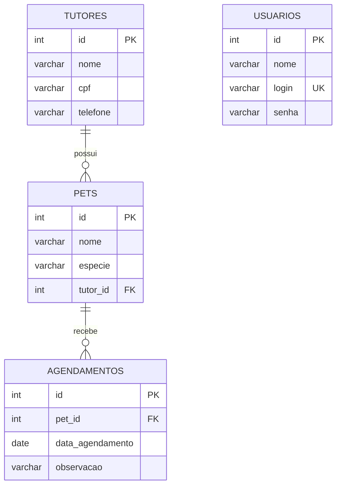

# SQL + documentação: pontos que não dependem de CSS

As duas bases usam PostgreSQL (`pg`), com `SERIAL`, `ILIKE`, `$1` e `RETURNING`. Não troque por sintaxe MySQL (`AUTO_INCREMENT`, `?`) no meio da prova.

## Relações



Usuários autenticam funcionários e não são tutores. Não invente FK entre eles sem requisito. Um tutor pode ter vários pets; cada pet tem um tutor. O esquema completo está em `solucoes/veterinaria/schema.sql`.

| Veterinária | Oficina |
|---|---|
| tutores | clientes |
| pets.nome, pets.especie, pets.tutor_id | veiculos.placa, veiculos.modelo, veiculos.cliente_id |
| agendamentos.pet_id | ordens_servico.veiculo_id |
| data_agendamento, observacao | data_abertura, descricao |

## Ordem de criação/população

Crie usuários e tutores; depois pets; depois agendamentos. Insira pais antes de filhos. Para remover tabelas, a ordem de dependência é inversa. Nunca rode DROP em banco com trabalho que precisa preservar.

```sql
SELECT a.id, a.data_agendamento, p.nome AS pet_nome,
       t.nome AS tutor_nome, t.telefone
FROM agendamentos a
JOIN pets p ON p.id = a.pet_id
JOIN tutores t ON t.id = p.tutor_id
ORDER BY a.data_agendamento ASC;
```

Este exemplo curto mostra o caminho; a rota completa devolve os demais campos e trata CPF.

Execute `npm run sql:gerar` para produzir `sql/veterinaria-completo.sql` e `sql/oficina-completo.sql`: criação e 3 INSERTs por tabela com senha em hash e CPF cifrado pelo MESMO utilitário. Importe em banco vazio. `schema.sql` sozinho não cumpre população; `seed.js` popula por código e o arquivo gerado é a entrega SQL de exemplo.

## Modelo de documentação

Use [modelo-documentacao.md](../modelos/modelo-documentacao.md). Preencha com o tema que cair. O material do professor pede PDF e DER em imagem/PDF: Markdown não substitui esses formatos na entrega. Na prova, use o editor disponível e exporte PDF; aqui o modelo é para treinar conteúdo.

Requisito funcional descreve ação verificável: “O sistema deve permitir editar nome, CPF e telefone de um tutor existente.” Evite escrever apenas “tela bonita” ou “cadastro”. Infraestrutura deve citar linguagem, runtime e SGBD.
